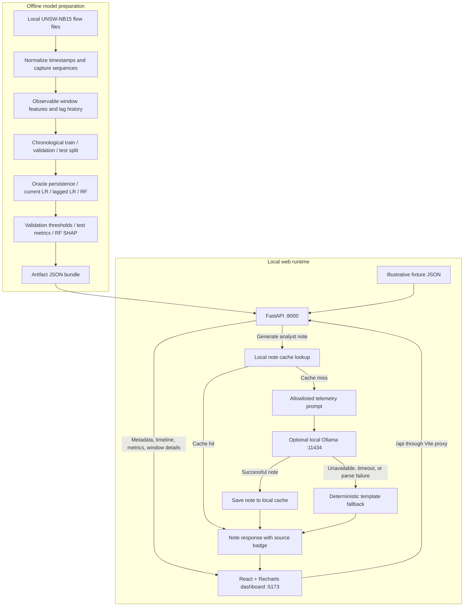

# Argus

**Argus** is a local, privacy-first, one-window-ahead network risk-scoring and early-warning engine. It models chronological flow telemetry to predict attack risk in the *next* time window, computes local SHAP feature attributions, and provides local, air-gapped analyst notes using an on-device Gemma LLM without dataset ground-truth leakage.

---

## Architecture

Argus separates offline model preparation from the local web runtime. The dashboard reads precomputed test-period scores through FastAPI; opening a page does not train a model or run live network inference. Ollama is optional and generates analyst notes only—it never changes a risk score.



### Components and source map

| Component | Source | Responsibility |
|---|---|---|
| Dataset adapter | `ml/adapters/unsw_nb15.py` | Normalize flow records, observation timestamps, labels, and sequence boundaries. |
| Window features and split | `ml/features.py`, `ml/split.py`, `configs/default.yaml` | Aggregate observable traffic, create lag history and next-window targets, and partition chronologically. Current configuration uses 1-second windows and 5-window lookback. |
| Training and evaluation | `ml/train.py`, `ml/evaluate.py` | Train LR and RF models, select predictive-model thresholds on validation, and compute test metrics including attack-onset recall. |
| Artifact export | `scripts/s6_artifacts.py` | Package per-window scores, selected RF SHAP explanations, metrics, and run metadata. |
| HTTP API | `backend/app/main.py` | Serve artifact or fixture data and handle window inspection and analyst-note requests. |
| Analyst-note services | `backend/app/services/` | Build prompts, call local Ollama, cache successful notes, and provide template fallback. |
| Web console | `frontend/src/App.tsx`, `frontend/src/AnalystReport.tsx`, `frontend/src/timeline.ts`, `frontend/src/types.ts` | Dashboard and model selection, sequence-aware risk timeline, inline analyst reports, window detail with SHAP and notes, Models comparison, and About page. |
| Development proxy | `frontend/vite.config.ts` | Forward `/api` requests to `127.0.0.1:8000`; `ARGUS_API_PORT` overrides the backend port. |

### Data contract and request flow

The API selects `fixtures/` with `USE_FIXTURES=1` (the default) or `artifacts/` with `USE_FIXTURES=0`. Fixtures are illustrative UI data, not benchmark results. The selected bundle contains:

- `timeline.json`: metadata and test windows, including default and per-model risk scores, alert flags, evaluation labels, counts, and available SHAP features.
- `metrics.json`: per-model thresholds, precision, recall, F1, PR-AUC, false-positive rate, onset recall, latency, and confusion matrices.
- `run_manifest.json`: run identity, dataset provenance, and configuration. Its run ID must match the timeline and metrics.
- `stage_map.json`: optional retrospective dataset-label context.

| Endpoint | Consumer and purpose |
|---|---|
| `GET /api/health` | Runtime mode and artifact availability; the API can start with a missing bundle. |
| `GET /api/meta` | Dataset, window size, default model and threshold, and split metadata. |
| `GET /api/timeline?split=test` | Lightweight window array for plotting, including `risk_by_model`. Optional `from` and `to` filters use window start timestamps. |
| `GET /api/metrics` | Dashboard KPIs and four-model comparison. |
| `GET /api/windows/{id}` | Full window details, counts, evaluation context, and SHAP features. |
| `POST /api/windows/{id}/note` | Cached, Gemma-generated, or template analyst note with source metadata. |

The risk chart retains all returned test windows, inserts null separators at sequence or time gaps, and draws adjacent attack periods as merged shading in one SVG layer. Changing the selected model switches scores, alert markers, threshold, and KPIs. Loading, empty, and failed requests have explicit UI states.

### Runtime boundaries

Model features use traffic observable by the prediction cutoff; next-window labels are evaluation targets. Oracle persistence uses the current ground-truth label and is explicitly non-deployable. Attack shading and stage context are evaluation-only. Risk scores are not calibrated probabilities.

The analyst-note prompt allows only risk, feature names and values, counts, and window timestamps. Ground-truth labels and retrospective stage context are excluded. Notes use the window's default-model artifact score, independently of the dashboard selector. Successful Gemma notes are cached by window ID and Ollama model name in `runtime/notes_cache.json`; `NOTES_CACHE_PATH` overrides the location. Regeneration bypasses the saved note. Dashboard reports render directly below their generation button, independently of window-detail loading, and stalled requests have a timeout and retry state.

The runtime uses local JSON files and localhost services, with no database or cloud inference service. Ollama listens at `localhost:11434`; `OLLAMA_MODEL` selects the model and `GEMMA_TIMEOUT_S` controls the timeout. Missing or invalid artifact bundles produce structured `503` responses. Ollama failures fall back to a template note.

### Verification map

- `tests/ml/`: feature availability, temporal leakage, sequence boundaries, and model evaluation checks.
- `tests/schemas/`: artifact contracts and push-lock protections.
- `tests/api/`: API responses, analyst-note generation, cache behavior, and prompt leakage guards.
- `frontend/tests/`: UI and timeline transforms; `frontend/tests/browser/` covers responsive demo flows, request states, and full real-timeline rendering.

---

## Prep vs Event Build

### 1. Prep Build (Pre-Event Skeleton & Tooling)
Built before the event to establish repository scaffolding, testing harnesses, and contract assertions:
- `0720cbd` `A0`: Rename Vigil to Argus and initialize project directory skeleton
- `f23da91` Update README repository metadata
- `20161e4` `S0`: Dataset inspection and decision framework
- `5f8f89e` `S0`: Parametrize `window_seconds` and evaluate chronological split semantics
- `d31da46` `S0`: Transition to 1-second window size and establish baseline configuration
- `ce99b77` `chore`: Test harness, contract schema validators, pre-push hook protections, and initial handoff

### 2. Event Build (Built Live During the Hackathon)
Everything from pipeline feature extraction to live model evaluation, API integration, and air-gapped LLM explanations was built during the event:
- **ML Pipeline & Predictive Models**:
  - `8b6906a` `S1`: UNSW-NB15 adapter with strict temporal semantics (`Stime` flow start vs `Ltime` observation boundary)
  - `25f4611` `S2`: Rolling window aggregation, lag features, target generation (`truth_next`), and boundary leakage tests
  - `ee7afe2` `S3`: Strict chronological partition (`train_end_ts`, `val_end_ts`, `test_start_ts`) and baseline models (`oracle_persistence`, `lr_current`, `lr_lag`)
  - `f2c7291` `S4`: Random Forest model with train-only class weighting
  - `25df238` `S5`: Test partition evaluation, confusion matrices, and `metrics.json` generation
  - `1de60fb` `S6`: SHAP feature importance extraction and final artifact bundle (`timeline.json`, `metrics.json`, `run_manifest.json`)
- **FastAPI Backend & React Dashboard**:
  - `a5a5228` `Gate 0`: Fixture-backed API routes and initial React/Vite dashboard shell
  - `5325da1` `TASK 1c`: Real artifact loading (`USE_FIXTURES=0`), interactive SVG timeline, flagged window KPIs, and SHAP modal inspection
- **Offline LLM Integration & Leakage Guards**:
  - `50b3511` `TASK 2a`: Ollama client with strict JSON validation, timeouts, and deterministic template fallback
  - `c2f492f` `TASK 2b`: LLM prompt builder with hard allowlist/denylist preventing ground-truth leakage
  - `dfcff65` `TASK 2c`: Robust local notes cache (`artifacts/notes_cache.json`) with corruption handling
  - `712c89d` `TASK 2d`: Analyst note endpoint (`POST /api/windows/{id}/note`) and unit test suite
  - `a84ceec` / `1f8b1de` `TASK 3` / `TASK I`: Detail modal analyst note panel with loading, Gemma, fallback, and error states
  - `b7662da` `TASK A`: Strict removal of ground truth from fallback notes
  - `084d74b` `TASK B`: Wire-level leakage test verifying raw HTTP payloads sent to Ollama
  - `21f3bd2` `TASK D`: Configurable Gemma timeout via `GEMMA_TIMEOUT_S` (default 60s)
  - `737e520` `TASK J`: Step-by-step 90-second demo script (`docs/DEMO.md`)

---

## How to Run

### 1. Prerequisites & Setup
Ensure Python 3.11+ and Node.js 18+ are available, then run:
```bash
make setup
```
*(Installs backend virtual environment requirements and frontend npm dependencies).*

### 2. Start the Backend API (Real Artifacts)
Launch the FastAPI server with real ML pipeline artifacts:
```bash
USE_FIXTURES=0 .venv/bin/python -m uvicorn backend.app.main:app --host 127.0.0.1 --port 8000
```

### 3. Start the Frontend Dashboard
In a separate terminal, launch the Vite development server:
```bash
cd frontend && npm run dev
```
Open [http://localhost:5173](http://localhost:5173) in your browser.

### 4. (Optional) Run Local Gemma for Analyst Notes
If using live LLM inference instead of the deterministic template fallback:
```bash
ollama run gemma4:e2b-mlx
```

### 5. Running Tests
To run the full test suite (backend pytest + frontend production build):
```bash
make test
```

---

## Dataset Citation

> Moustafa, Nour, and Jill Slay. *"UNSW-NB15: a comprehensive data set for network intrusion detection systems (UNSW-NB15 network data set)."* 2015 Military Communications and Information Systems Conference (MilCIS). IEEE, 2015.

---

## Limitations

> **Limitations Note:** Evaluated on benchmark network flow traffic with an attack-dense chronological test partition (88.6% positive rate); real-world SOC deployment requires operational baseline re-calibration and continuous domain-specific adaptation.
