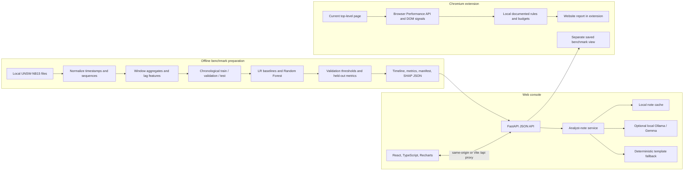

# Argus

**A benchmark-backed console for one-window-ahead network risk scoring, plus a Chromium extension for inspecting browser-visible website signals.**

**License:** MIT

Argus explores whether recent network-flow patterns can help identify malicious activity in the *next* one-second window. Its console presents a chronological UNSW-NB15 evaluation, model comparisons, selected Random Forest explanations, and optional analyst notes. A separate Chrome/Brave extension reports rule-based signals from the website currently open in the browser.

> **Scope:** Argus is a benchmark research prototype, not a production intrusion detection system. The saved ML benchmark does not score arbitrary websites or live network traffic. The extension does not use the benchmark model and is not a vulnerability scanner or safety verdict.

**Live console:** [argus-console.antideploy.app](https://argus-console.antideploy.app)

## What Argus does

### Web console

- Plots all test-period risk scores with model selection, validation-selected thresholds, flagged windows, and evaluation-only attack shading.
- Shows test KPIs and a comparison of persistence, current-window logistic regression, lagged logistic regression, and Random Forest.
- Opens a window detail view with traffic counts and available per-window SHAP values.
- Generates an analyst note from operational outputs. A local Gemma model can write the note through Ollama; otherwise Argus labels its deterministic template fallback. Notes do not affect risk scores and exclude ground-truth labels.
- Includes method, dataset provenance, split details, limitations, and claims guidance.

### Chromium extension

- Inspects browser-visible measurements for the current top-level HTTP/HTTPS page after the user invokes the extension.
- Summarizes retained resource timing, visible transfer and status data, insecure resource references, and form-action signals.
- Uses fixed, documented demonstration budgets and a transparent rule indicator. Results stay in the extension and are separate from the benchmark ML scores.
- Includes a saved benchmark dashboard for exploring the historical test artifacts; these scores remain the same across websites by design.

See [the extension guide](frontend/extension/README.md) for installation, permissions, coverage, privacy, and the controlled local demo.

## How the benchmark works

The pipeline maps UNSW-NB15 flow start time (`Stime`) and feature-availability time (`Ltime`), groups observable flows into fixed windows within capture sequences, and builds aggregate and lagged traffic features. A sample uses information available by the end of its input window to score whether the following window contains malicious activity. The split is chronological: 70% training, 10% validation, and 20% test. Predictive-model alert thresholds are selected on validation data; final metrics are reported on the held-out test period.

The four comparisons have different roles:

| Model | Role |
|---|---|
| `oracle_persistence` | Diagnostic upper-context baseline using current-window ground truth; **non-deployable**. |
| `lr_current` | Deployable logistic-regression baseline using current-window features. |
| `lr_lag` | Logistic regression using lagged features. |
| `rf` | Random Forest using the lagged feature set; default console model. |

Model outputs are **risk scores**, not calibrated probabilities. Attack periods and stage labels are evaluation context, not model inputs or predictions.

## Current benchmark snapshot

The committed artifact bundle contains 17,240 one-second test windows. The test partition is attack-dense: 88.6% of next-window targets are malicious, with 1,703 attack-onset windows. Current results from `artifacts/metrics.json` are:

| Model | PR-AUC | F1 | Recall | Onset recall | FPR | Threshold | Latency (ms/window) |
|---|---:|---:|---:|---:|---:|---:|---:|
| Oracle persistence | N/A | 88.85% | 88.86% | 0.00% | 87.03% | N/A | 0.00 |
| Current-window LR | 0.8946 | 94.09% | 99.99% | 100.00% | 98.01% | 0.01045 | 0.06 |
| Lagged LR | 0.8956 | 94.08% | 99.99% | 99.94% | 98.06% | 0.00624 | 0.06 |
| Random Forest | 0.9024 | 93.98% | 100.00% | 100.00% | 100.00% | 0.00000 | 16.53 |

**Operating-point caveat:** the current validation-selected Random Forest threshold is `0.0`, so it flags every test window, including every benign target window. Its high recall and PR-AUC do not make that alert threshold operationally useful. The high false-positive rates and attack-heavy test distribution limit what these scores establish. The dataset decision and caveats are documented in [`docs/DATA_DECISION.md`](docs/DATA_DECISION.md); do not present this result as production detection performance.

## Architecture



### Repository map

| Path | Purpose |
|---|---|
| `ml/` | UNSW-NB15 adapter, window features, chronological split, training, evaluation. |
| `scripts/` | Dataset preparation helpers, artifact export, environment checks, and local extension demo server. |
| `backend/app/` | FastAPI routes, artifact loading, analyst-note prompt, Ollama client, cache, and web-serving entry point. |
| `frontend/src/` | React console, timeline transforms, analyst report UI, and shared styles. |
| `frontend/extension/` | Chromium Manifest V3 extension source. |
| `artifacts/` | Committed test-period scores, metrics, and run manifest used by the real-data console. |
| `fixtures/` | Small illustrative API data for development and UI checks; not benchmark results. |
| `configs/` | Windowing and model configuration, plus generated local training intermediates. |
| `tests/` and `frontend/tests/` | Python API, ML/schema, React, timeline, and extension checks. |
| `docs/` | Dataset decision and demo notes. |

Raw dataset files are not included. The pipeline expects local files such as `UNSW-NB15_1.csv` through `UNSW-NB15_4.csv` under `data/raw/`.

## Quick start

### Requirements

- Python 3.12 or newer
- Node.js 22 recommended
- npm
- Ollama only if you want to generate notes with a local Gemma model

Create a virtual environment and install the Python and frontend dependencies:

```bash
python3 -m venv .venv
.venv/bin/python -m pip install --upgrade pip
.venv/bin/python -m pip install -e '.[explain,test]'
npm --prefix frontend ci
```

Start the API in one terminal. Fixture mode is the default and is clearly labeled in the console:

```bash
.venv/bin/python -m uvicorn backend.app.main:app --host 127.0.0.1 --port 8000
```

To use the committed benchmark artifacts instead:

```bash
USE_FIXTURES=0 NOTES_CACHE_PATH=runtime/notes_cache.json .venv/bin/python -m uvicorn backend.app.main:app --host 127.0.0.1 --port 8000
```

Start the frontend in a second terminal:

```bash
npm --prefix frontend run dev
```

Open [http://127.0.0.1:5173](http://127.0.0.1:5173). Vite forwards `/api` requests to the local API at port 8000. Set `ARGUS_API_PORT` to use a different backend port.

### Optional local Gemma notes

Install the model in Ollama and keep it available locally:

```bash
ollama run gemma4:e2b-mlx
```

Start the backend with the model selected in its environment, for example:

```bash
OLLAMA_MODEL=gemma4:e2b-mlx USE_FIXTURES=0 .venv/bin/python -m uvicorn backend.app.main:app --host 127.0.0.1 --port 8000
```

If Ollama is unavailable or its response is incomplete, the console shows a labeled template fallback. The hosted console uses that fallback unless its optional local notes bridge is running and configured; see [`frontend/ANTIDEPLOY.md`](frontend/ANTIDEPLOY.md).

## Install the Chromium extension

1. Open `chrome://extensions` in Chrome or `brave://extensions` in Brave.
2. Enable **Developer mode** and choose **Load unpacked**.
3. Select this repository’s `frontend/extension/` directory.
4. Visit an ordinary website and invoke Argus from the extension toolbar.

The extension uses temporary page access after a user action. It does not submit forms, probe servers, inspect response bodies, or send website snapshots to the Argus backend. Browser measurements can be incomplete due to caching and cross-origin browser restrictions. Read the [full extension guide](frontend/extension/README.md) before interpreting the indicator.

For a controlled local walkthrough, run:

```bash
python3 frontend/scripts/serve-extension-demo.py
```

Then open [http://127.0.0.1:8765](http://127.0.0.1:8765) in Chromium and follow the prompts on the page. Its deliberate 503 responses and form examples are test stimuli, not attacks.

## API

The local API is served by `backend.app.main:app` during development. The deployed application uses `backend.app.web:app`, which serves the compiled frontend and API on one port.

| Method | Endpoint | Description |
|---|---|---|
| `GET` | `/api/health` | Runtime mode and artifact availability. |
| `GET` | `/api/meta` | Dataset, window, model, threshold, and split metadata. |
| `GET` | `/api/timeline?split=test` | Lightweight time-ordered window scores; supports optional `from` / `to` timestamp filters. |
| `GET` | `/api/metrics` | Test metrics and model thresholds. |
| `GET` | `/api/windows/{id}` | Window counts, evaluation context, and available SHAP values. |
| `POST` | `/api/windows/{id}/note` | Cached Gemma note or deterministic template fallback. Use `?refresh=true` to regenerate. |

The API validates that timeline, metrics, and run-manifest IDs match before serving artifacts. Fixtures use `USE_FIXTURES=1`; committed benchmark artifacts use `USE_FIXTURES=0`.

## Run checks

```bash
make doctor
make fixtures-check
make test
npm --prefix frontend test
npm --prefix frontend run test:extension
```

`make test` runs the Python suite and production frontend build. The additional npm commands run frontend unit tests and extension unit tests. Browser tests require an installed Chromium-compatible browser; see [`frontend/extension/README.md`](frontend/extension/README.md) for commands and setup.

## Dataset and artifact reproducibility

The raw UNSW-NB15 files are not included. To reproduce training, obtain them from the [official dataset page](https://research.unsw.edu.au/projects/unsw-nb15-dataset), review its terms, and place `UNSW-NB15_1.csv` through `UNSW-NB15_4.csv` in `data/raw/`.

The repository contains preparation, training, evaluation, and artifact-export scripts, but the final exporter does not yet emit the complete runtime artifact bundle required by the API. Treat the committed files in `artifacts/` as the demo bundle; do not overwrite them with a fresh export and publish it until the exporter is aligned with the documented artifact schema. See [`docs/DATA_DECISION.md`](docs/DATA_DECISION.md) for the dataset choice and temporal caveats.

Intermediate training outputs are written under `configs/`. Validate any regenerated bundle against `tests/schemas/` and the API’s artifact loading requirements before using it in the console.

## Deployment

The console is deployed at [argus-console.antideploy.app](https://argus-console.antideploy.app). Antideploy builds the Docker image from the repository’s `Dockerfile`; the image contains the compiled Vite app, FastAPI service, and the three required benchmark JSON files. Local datasets, training intermediates, credentials, and note caches are excluded.

Deployment setup, the optional local Gemma bridge, and verification steps are in [`frontend/ANTIDEPLOY.md`](frontend/ANTIDEPLOY.md). An alternative Cloudflare Pages and Tunnel setup is documented in [`frontend/CLOUDFLARE.md`](frontend/CLOUDFLARE.md). The hosted console remains a historical benchmark demo; deploying it does not make it a live website scanner or network sensor.

## Dataset citation

Moustafa, Nour, and Jill Slay. “UNSW-NB15: a comprehensive data set for network intrusion detection systems (UNSW-NB15 network data set).” *2015 Military Communications and Information Systems Conference (MilCIS).* IEEE, 2015. [Dataset project page](https://research.unsw.edu.au/projects/unsw-nb15-dataset).

## Limitations and claims

- The evaluation uses one public benchmark dataset and an attack-dense test period; it does not establish performance on another organization’s network or unseen attack families.
- Random Forest currently flags all test windows at its selected zero threshold. Do not present its 100% recall as evidence of a practical alerting system.
- The project does not capture packets, monitor server-side flows, block traffic, or remediate incidents.
- The extension inspects only signals exposed by the current top-level browser page. It cannot see server-side network flows, most headers, request/response bodies, all cross-origin timing data, or all page contexts.
- The extension’s performance budgets are demonstration settings, not security standards. A zero rule indicator does not establish that a site is safe.
- Ground-truth labels and stage context are for retrospective evaluation only. Gemma does not receive them and does not affect scores.

Use “one-window-ahead risk-scoring experiment” and “risk score.” Do not describe Argus as a production IDS, a live attack detector, a calibrated probability model, or an unseen-attack predictor. More detail is available in the console’s About page and [`PRD.md`](PRD.md).

## License

Argus is released under the [MIT License](LICENSE).
